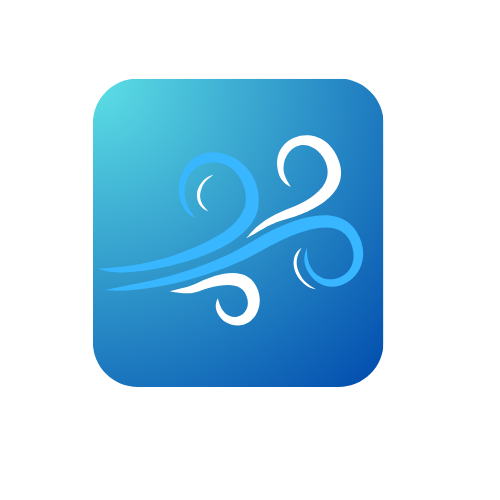

# LuNo

<p align="center">
  
</p>

LuNo is a Flutter app being developed for an indoor air quality monitoring system as part of my bachelor's project at the Technical University of Košice.

The goal is to make environmental measurements easy to understand, with a clear overview of room conditions and detailed charts for exploring trends.

## Project status

**Work in progress — UI prototype.** The current version displays sample readings and generated chart data. Device discovery is simulated. Live sensor communication, real measurement history, and background alerts are not implemented yet.

The planned system pairs the app with a Raspberry Pi Pico 2 W and environmental sensors over local Wi-Fi, without requiring an external server.

## Current prototype

- Air quality dashboard with humidity, PM2.5, temperature, and CO₂ sample readings.
- Simple and advanced views, including metric selection and trend charts.
- Explanations of the displayed measurements.
- Guided onboarding with simulated device discovery.
- Screens for history, devices, notifications, and settings.
- Local preferences using `shared_preferences`.

The sample values and status labels demonstrate the interface; they do not represent live measurements or a validated safety assessment.

## Technologies

- **Flutter and Dart** — application and interface.
- **fl_chart** — charts and data visualization.
- **shared_preferences** — local preferences.
- **Material Design** — interface components.

## Run locally

Install Flutter with a bundled Dart SDK compatible with **Dart 3.10.1 or newer within the 3.x series**, as required by `pubspec.yaml`. Set up an emulator or connect a supported device.

From the project directory:

```sh
flutter pub get
flutter devices
flutter run
```

To select a particular device:

```sh
flutter run -d <device-id>
```

Platform folders are included for mobile, desktop, and web. Their presence does not imply that every platform has been tested.

## Project structure

```text
lib/
├── main.dart           # Application entry point
└── ui/
    ├── app_shell.dart  # Main navigation
    ├── screens/        # Dashboard, history, devices, notifications, settings
    ├── setup/          # Onboarding flow
    ├── splash/         # Splash screen
    └── widgets/        # Reusable UI components
assets/
└── LuNo.png            # App icon
```

## Planned development

- Connect to the Raspberry Pi Pico 2 W over local Wi-Fi.
- Replace sample values with live sensor readings.
- Store and display real measurement history.
- Add configurable alerts and handle connection interruptions.
- Test the app with the physical sensor prototype.

## Author

Richard Mezei — student at the Technical University of Košice, Faculty of Electrical Engineering and Informatics.
